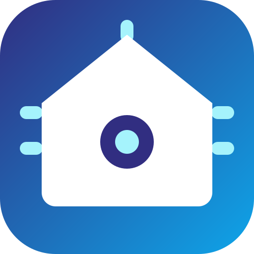

<p align="center">
  
</p>

<h1 align="center">Tuya Selfhost</h1>

<p align="center">
  Tus dispositivos Tuya y Smart&nbsp;Life controlados por tu propia red.<br>
  Sin nube, sin cuenta de desarrollador, sin internet para encender una luz.
</p>

<p align="center">
  <a href="https://github.com/constantini-ha/tuya-selfhost/releases"></a>
  
  
  
</p>

<p align="center">
  <a href="README.md">English</a> · <a href="README.pt-BR.md">Português</a> · <b>Español</b>
</p>

---

## Qué cambia

```
         NUBE                               LOCAL

  📱 ──▶ ☁️  ──▶ 🏠 💡            📱 ──▶ 🏠 💡

  3 saltos, ~800 ms                 1 salto, ~40 ms
  cae cuando cae internet           sigue funcionando
  el fabricante lo ve todo          nada sale de tu red
```

Una vez configurado, puedes **bloquear el dispositivo en el router** y sigue
respondiendo. La acción `network_report` lista la MAC de cada uno justo para eso.

## Instalación

[](https://my.home-assistant.io/redirect/hacs_repository/?owner=constantini-ha&repository=tuya-selfhost&category=integration)

En **Marketplace** (o HACS antes de 2026.11), añade `constantini-ha/tuya-selfhost`
como repositorio personalizado de tipo integración, instala y reinicia.

## Añadir un dispositivo

[](https://my.home-assistant.io/redirect/config_flow_start/?domain=tuya_selfhost)

```
  ┌─ asistido por la nube (recomendado) ────────────────────┐
  │  login por QR en la app  →  eliges el dispositivo        │
  │  →  encuentra su IP solo  →  listo                       │
  └──────────────────────────────────────────────────────────┘
  ┌─ manual ────────────────────────────────────────────────┐
  │  tú indicas device id, local key, IP y protocolo         │
  └──────────────────────────────────────────────────────────┘
```

El login por QR solo sirve para obtener la `local_key`; la clave se guarda y la
sesión no. Campo a campo en **[CONFIGURATION.md](CONFIGURATION.md)**, y cómo
encontrar los datos a mano en **[DEVICE_DETAILS.md](DEVICE_DETAILS.md)**.

**¿Volviste a emparejar el dispositivo en la app?** Usa **Reconfigurar** en la
entrada en lugar de borrarla: entity ids, historial, área y códigos aprendidos
viajan con ella.

## Dispositivos compatibles

**[DEVICES.md](DEVICES.md) lista las 1676 configuraciones**, por categoría.

| Cómo conecta | Qué cubre |
| --- | --- |
| **Wi-Fi, directo** | El grueso del catálogo: interruptores, enchufes, luces, climatización, ventiladores, cerraduras, sensores, persianas, aspiradoras, termos |
| **Zigbee tras una pasarela Tuya** | Subdispositivos alcanzados por el hub, configurados con su `device_cid`. La pasarela mantiene su nube; los subdispositivos no la necesitan |
| **IR y RF por blaster** | Cualquier aparato, copiando su mando original — ver abajo |
| **Bluetooth** | Todavía no. Los módulos Wi-Fi lo anuncian y la base está en preparación |

¿Falta el tuyo? El log del config flow imprime lo necesario para abrir una
[issue](https://github.com/constantini-ha/tuya-selfhost/issues), y escribir una
configuración nueva es solo un YAML, documentado en
[custom_components/tuya_selfhost/devices/README.md](custom_components/tuya_selfhost/devices/README.md).

## Constructor de mandos IR y RF

Abre **Controles Tuya** en la barra lateral. ¿Ninguna integración de protocolo
funciona con tu aire acondicionado? Copia el mando de verdad.

```
  Controles Tuya                                   [Añadir al panel]
  ┌────────────┬────────────┬────────────┐
  │  ❄ Frío 22 │  ⏻ Apagar  │     +      │   toque sin código  → aprende
  │  aprendido │  aprendido │            │   toque con código  → prueba
  │  ← → ⟳ ✕   │  ← → ⟳ ✕   │            │   ← →  posición
  └────────────┴────────────┴────────────┘
       cada captura pregunta:  Probar · Conservar · Descartar
```

Funciona con cualquier marca, porque no depende de ningún protocolo — es tu propia
señal, grabada y repetida. Receta completa en
**[LEARNED_REMOTES.es.md](LEARNED_REMOTES.es.md)** ·
[en](LEARNED_REMOTES.md) · [pt-BR](LEARNED_REMOTES.pt-BR.md)

## Alexa

La acción **Configuración de Alexa** genera el bloque `alexa:` completo a partir de
tus entidades, listo para pegar. La guía cubre la skill self-hosted sin Nabu Casa y
la trampa del informe proactivo, que es lo que hace que la app de Alexa siga el
estado de verdad: **[ALEXA.es.md](ALEXA.es.md)** · [en](ALEXA.md) ·
[pt-BR](ALEXA.pt-BR.md)

## Cuando algo falla

Errores 901, 905 y 914, dispositivos que desaparecen de la red, cerraduras,
pasarelas y blasters: **[TROUBLESHOOTING.md](TROUBLESHOOTING.md)**.

## Acciones

| Acción | Qué hace |
| --- | --- |
| `tuya_selfhost.network_report` | Lista IP y MAC de cada dispositivo y cuáles se pueden bloquear de internet |
| `tuya_selfhost.alexa_config` | Genera el bloque `alexa:` completo a partir de tus entidades |
| `tuya_selfhost.send_learned_ir_command` | Envía un código aprendido por un emisor infrarrojo |

## Contribuir

Issues y pull requests son bienvenidos. Una configuración de dispositivo nuevo es
la contribución más útil: un YAML en `custom_components/tuya_selfhost/devices/` y
una prueba.

## Licencia

[MIT](LICENSE.md).
