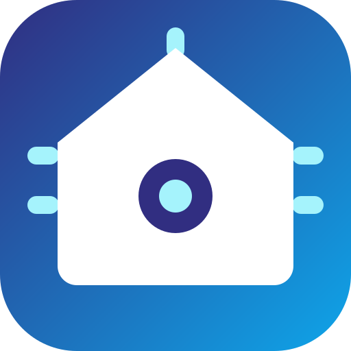

<p align="center">
  
</p>

<h1 align="center">Tuya Selfhost</h1>

<p align="center">
  Seus aparelhos Tuya e Smart&nbsp;Life controlados pela rede local.<br>
  Sem nuvem, sem conta de desenvolvedor, sem depender da internet para acender uma luz.
</p>

<p align="center">
  <a href="https://github.com/constantini-ha/tuya-selfhost/releases"></a>
  
  
  
</p>

---

## O que muda

```
         NUVEM                              LOCAL
                                   
  📱 ──▶ ☁️  ──▶ 🏠 💡            📱 ──▶ 🏠 💡
                                   
  3 saltos, ~800 ms                 1 salto, ~40 ms
  cai quando a internet cai         funciona na queda de energia da operadora
  o fabricante vê tudo              nada sai da sua rede
```

Depois de configurado, você pode **bloquear o aparelho no roteador** e ele continua
respondendo normalmente. A ação `network_report` lista o MAC de cada um justamente
para isso.

## Instalação

[](https://my.home-assistant.io/redirect/hacs_repository/?owner=constantini-ha&repository=tuya-selfhost&category=integration)

No **Marketplace** (ou HACS, nas versões anteriores a 2026.11), adicione
`constantini-ha/tuya-selfhost` como repositório personalizado do tipo integração,
instale e reinicie.

## Adicionando um aparelho

[](https://my.home-assistant.io/redirect/config_flow_start/?domain=tuya_selfhost)

```
  ┌─ pela nuvem (recomendado) ──────────────────────────────┐
  │  login por QR no app  →  escolhe o aparelho da lista     │
  │  →  acha o IP sozinho  →  pronto                         │
  └──────────────────────────────────────────────────────────┘
  ┌─ manual ────────────────────────────────────────────────┐
  │  você informa device id, local key, IP e protocolo       │
  └──────────────────────────────────────────────────────────┘
```

O login por QR serve só para buscar a `local_key`; ela fica salva e a sessão não
é guardada. Detalhes de cada campo em **[CONFIGURATION.md](CONFIGURATION.md)**,
e como achar os dados na mão em **[DEVICE_DETAILS.md](DEVICE_DETAILS.md)**.

**Trocou o aparelho no app?** Use **Reconfigurar** no menu da entrada em vez de
apagá-la: entity_ids, histórico, área e códigos aprendidos vão junto.

## Construtor de controles IR e RF

Abra **Controles Tuya** na barra lateral. Nenhuma integração de protocolo
funciona com o seu ar-condicionado? Copie o sinal do controle de verdade.

```
  Controles Tuya                                   [Adicionar ao painel]
  ┌────────────┬────────────┬────────────┐
  │  ❄ Frio 22 │  ⏻ Desligar│     +      │   toque sem código  → aprende
  │  aprendido │  aprendido │            │   toque com código  → testa
  │  ← → ⟳ ✕   │  ← → ⟳ ✕   │            │   ← →  posição
  └────────────┴────────────┴────────────┘
       cada captura pergunta:  Testar · Manter · Descartar
```

Funciona com qualquer marca, porque não depende de protocolo nenhum — é o seu
próprio sinal, gravado e repetido. Receita completa em
**[LEARNED_REMOTES.pt-BR.md](LEARNED_REMOTES.pt-BR.md)**
· [en](LEARNED_REMOTES.md) · [es](LEARNED_REMOTES.es.md)

## Alexa

A ação **Configuração da Alexa** monta o bloco `alexa:` inteiro com todas as suas
entidades, prontinho para colar. O guia cobre a skill self-hosted sem Nabu Casa e
a pegadinha do relatório proativo, que é o que faz o app da Alexa acompanhar o
estado de verdade: **[ALEXA.pt-BR.md](ALEXA.pt-BR.md)** · [en](ALEXA.md) ·
[es](ALEXA.es.md)

## Aparelhos suportados

Mais de 1.600 configurações em [DEVICES.md](DEVICES.md). Se o seu não estiver lá,
o log do config flow mostra os dados que você precisa abrir numa
[issue](https://github.com/constantini-ha/tuya-selfhost/issues) — e escrever uma
configuração nova é só um YAML, documentado em
[custom_components/tuya_selfhost/devices/README.md](custom_components/tuya_selfhost/devices/README.md).

## Quando algo não funciona

Erros 901, 905 e 914, aparelhos que somem da rede, fechaduras, hubs e blasters:
**[TROUBLESHOOTING.md](TROUBLESHOOTING.md)**.

## Ações

| Ação | O que faz |
| --- | --- |
| `tuya_selfhost.network_report` | Lista IP e MAC de cada aparelho e diz quais dá para bloquear na internet |
| `tuya_selfhost.alexa_config` | Gera o bloco `alexa:` completo com suas entidades |
| `tuya_selfhost.send_learned_ir_command` | Dispara um código aprendido por um emissor infravermelho |

## Contribuindo

Issues e pull requests são bem-vindos. Configuração de aparelho novo é a
contribuição mais útil: um YAML em `custom_components/tuya_selfhost/devices/`
e um teste.

## Créditos

MIT. O projeto nasceu a partir de
[make-all/tuya-local](https://github.com/make-all/tuya-local) e segue
reconhecendo essa base em [ACKNOWLEDGEMENTS.md](ACKNOWLEDGEMENTS.md) e
[LICENSE.md](LICENSE.md). Para apoiar o trabalho original:
[BuyMeCoffee do Jason Rumney](https://www.buymeacoffee.com/jasonrumney).
