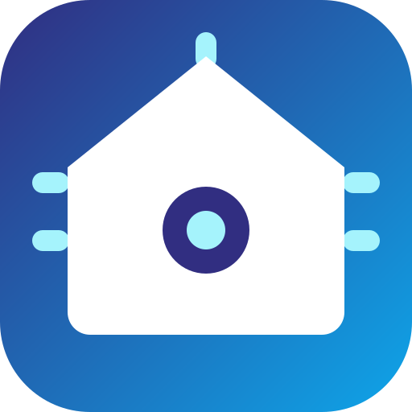

<p align="center">
  
</p>

<h1 align="center">Tuya Selfhost</h1>

<p align="center">
  Seus aparelhos Tuya e Smart&nbsp;Life controlados pela sua própria rede.<br>
  Sem nuvem, sem conta de desenvolvedor, sem internet para acender uma luz.
</p>

<p align="center">
  <a href="https://github.com/constantini-ha/tuya-selfhost/releases"></a>
  
  
  
</p>

<p align="center">
  <a href="README.md">English</a> · <b>Português</b> · <a href="README.es.md">Español</a>
</p>

---

## O que muda

```
         NUVEM                              LOCAL

  📱 ──▶ ☁️  ──▶ 🏠 💡            📱 ──▶ 🏠 💡

  3 saltos, ~800 ms                 1 salto, ~40 ms
  cai quando a internet cai         continua funcionando
  o fabricante vê tudo              nada sai da sua rede
```

Depois de configurado, você pode **bloquear o aparelho no roteador** e ele continua
respondendo. A ação `network_report` lista o MAC de cada um justamente para isso.

## Instalação

[](https://my.home-assistant.io/redirect/hacs_repository/?owner=constantini-ha&repository=tuya-selfhost&category=integration)

No **Marketplace** (ou HACS, antes do 2026.11), adicione `constantini-ha/tuya-selfhost`
como repositório personalizado do tipo integração, instale e reinicie.

## Adicionando um aparelho

[](https://my.home-assistant.io/redirect/config_flow_start/?domain=tuya_selfhost)

```
  ┌─ pela nuvem (recomendado) ──────────────────────────────┐
  │  login por QR no app  →  escolhe o aparelho da lista     │
  │  →  acha o IP sozinho  →  pronto                         │
  └──────────────────────────────────────────────────────────┘
  ┌─ manual ────────────────────────────────────────────────┐
  │  você informa device id, local key, IP e protocolo       │
  └──────────────────────────────────────────────────────────┘
```

O login por QR serve só para buscar a `local_key`; ela fica salva e a sessão não.
Campo a campo em **[CONFIGURATION.md](CONFIGURATION.md)**, e como achar os dados na
mão em **[DEVICE_DETAILS.md](DEVICE_DETAILS.md)**.

**Re-pareou o aparelho no app?** Use **Reconfigurar** na entrada em vez de apagá-la:
entity_ids, histórico, área e códigos aprendidos vão junto.

## Aparelhos suportados

**O [DEVICES.md](DEVICES.md) lista as 1.676 configurações**, por categoria.

| Como conecta | O que cobre |
| --- | --- |
| **Wi-Fi, direto** | O grosso do catálogo: interruptores, tomadas, luzes, climatização, ventiladores, fechaduras, sensores, cortinas, aspiradores, aquecedores |
| **Zigbee atrás de um gateway Tuya** | Sub-aparelhos alcançados pelo hub, configurados com o `device_cid`. O gateway mantém a nuvem dele; os sub-aparelhos não precisam |
| **IR e RF por blaster** | Qualquer aparelho, copiando o controle original — veja abaixo |
| **Bluetooth** | Ainda não. Os módulos Wi-Fi anunciam BLE, e a base está sendo preparada |

Não achou o seu? O log do config flow mostra os dados para abrir uma
[issue](https://github.com/constantini-ha/tuya-selfhost/issues), e escrever uma
configuração nova é só um YAML, documentado em
[custom_components/tuya_selfhost/devices/README.md](custom_components/tuya_selfhost/devices/README.md).

## Construtor de controles IR e RF

Abra **Tuya Selfhost** na barra lateral. Nenhuma integração de protocolo funciona
com o seu ar-condicionado? Copie o controle de verdade.

```
  Tuya Selfhost                                   [Adicionar ao painel]
  ┌────────────┬────────────┬────────────┐
  │  ❄ Frio 22 │  ⏻ Desligar│     +      │   toque sem código  → aprende
  │  aprendido │  aprendido │            │   toque com código  → testa
  │  ← → ⟳ ✕   │  ← → ⟳ ✕   │            │   ← →  posição
  └────────────┴────────────┴────────────┘
       cada captura pergunta:  Testar · Manter · Descartar
```

Funciona com qualquer marca, porque não depende de protocolo nenhum — é o seu próprio
sinal, gravado e repetido. Receita completa em
**[LEARNED_REMOTES.pt-BR.md](LEARNED_REMOTES.pt-BR.md)** ·
[en](LEARNED_REMOTES.md) · [es](LEARNED_REMOTES.es.md)

## Rede

A engrenagem no topo tem a aba **Rede**, com uma sub-aba por rádio. **Wi-Fi**
lista cada aparelho com endereço e MAC, pronto para bloquear no roteador.
**Bluetooth** mostra os rádios Tuya que o Home Assistant está ouvindo agora,
com o sinal — o aparelho de Wi-Fi que também tem Bluetooth aparece ali, porque
essa é a reserva dele quando o Wi-Fi cai. **Zigbee** pareia e lista o que está
na rede Zigbee do próprio Home Assistant.

Alguns aparelhos Zigbee da Tuya pareiam e não mostram tecla nenhuma, porque o
Home Assistant ainda não conhece o modelo. A correção para eles vem aqui dentro
e carrega sozinha, sem nada para instalar ou configurar. Coberto hoje: o
interruptor de seis teclas Nova Digital SA-6 (`_TZE28C1000000_gxbdnfrh`), que
ganha as seis teclas.

## Nome das teclas

Na página do aparelho, toque no nome embaixo de uma tecla para renomear; o
mesmo campo está nas configurações do aparelho. O nome vai para o registro de
entidades do Home Assistant, então dashboards e assistentes de voz também o
recebem. Deixar vazio traz o nome original de volta.

## Cenas

O botão **Cenas**, no topo do painel, abre a tela delas: um toque faz várias coisas de uma vez, como o
Executar do aplicativo Smart Life. Escolha um nome e um ícone, adicione os
passos — um aparelho para ligar ou desligar, uma tecla de controle aprendida
para pressionar, uma espera — e salve. A cena é um script comum do Home
Assistant com id começando em `tuya_scene_`, então também serve em dashboards
e automações.

Ao salvar, a cena vai para a Alexa na hora quando a skill self-hosted reporta
estado: diga "Alexa, ligar" e o nome da cena. O filtro do `alexa:` precisa
deixar passar, com `script.tuya_scene_*` em `include_entity_globs`; o bloco
gerado já traz essa linha.

## Alexa

A ação **Configuração da Alexa** monta o bloco `alexa:` inteiro a partir das suas
entidades, pronto para colar. O guia cobre a skill self-hosted sem Nabu Casa e a
pegadinha do relatório proativo, que é o que faz o app da Alexa acompanhar o estado
de verdade: **[ALEXA.pt-BR.md](ALEXA.pt-BR.md)** · [en](ALEXA.md) · [es](ALEXA.es.md)

## Quando algo não funciona

Erros 901, 905 e 914, aparelhos que somem da rede, fechaduras, hubs e blasters:
**[TROUBLESHOOTING.md](TROUBLESHOOTING.md)**.

## Ações

| Ação | O que faz |
| --- | --- |
| `tuya_selfhost.network_report` | Lista IP e MAC de cada aparelho e diz quais dá para bloquear na internet |
| `tuya_selfhost.alexa_config` | Gera o bloco `alexa:` completo a partir das suas entidades |
| `tuya_selfhost.send_learned_ir_command` | Dispara um código aprendido por um emissor infravermelho |

## Contribuindo

Issues e pull requests são bem-vindos. Configuração de aparelho novo é a
contribuição mais útil: um YAML em `custom_components/tuya_selfhost/devices/` e um
teste.

## Licença

[MIT](LICENSE.md).
